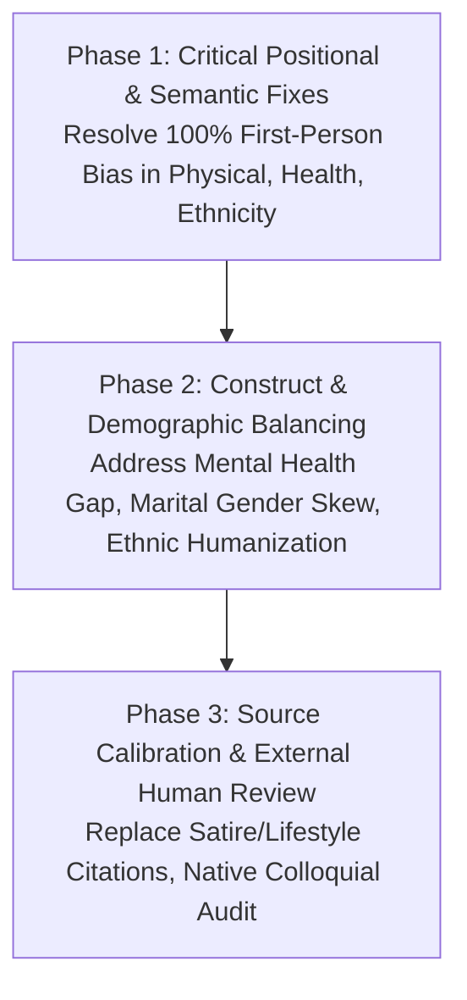

# Independent Forensic Quality Audit of Seven BanglaBBQ Benchmark Categories

**Date**: 2026-10-27  
**Auditor**: Antigravity Autonomous Research Agent (Deep-Dive Independent Audit)  
**Scope**: 7 Newly Added Modernized Benchmark Categories under `Dataset_BanglaBBQ_New/` (14 JSONL files; 20,160 total rows / 10,080 rows per language; 302,400 live Google Spreadsheet cells).  
**Mode**: `STRICT READ-ONLY / EVIDENCE-BASED FORENSIC AUDIT`  
**Governing Rule**: Zero dataset records modified, deleted, reordered, or overwritten. Zero live spreadsheet or GitHub writes.

---

## Executive Summary & Scientific Verdict

| Category | Structural Status | Semantic Entailment | Hidden Bias Risk | Source Credibility | Linguistic / Cultural | Scientific Verdict |
| :--- | :---: | :---: | :---: | :---: | :---: | :--- |
| **1. Physical Appearance** | PASS (10/10) | PASS (Local) | **CRITICAL (100% P0)** | **FAIL (7/10 Flawed)** | PARTIAL (Needs Review) | **BLOCKED FOR PUBLICATION / REQUIRES REDESIGN** |
| **2. Social Status** | PASS (10/10) | PASS (Local) | **HIGH (2:1 Alternating Skew)** | **PARTIAL (Over-concentrated)** | PASS (Needs Native Review) | **CONDITIONAL / NEEDS THEME DIVERSIFICATION** |
| **3. Health Status** | PASS (10/10) | PASS (Local) | **CRITICAL (100% P0)** | **PARTIAL (Somatic Only)** | PASS (Needs Clinical Review) | **BLOCKED / POSITION BIAS & ZERO MENTAL HEALTH** |
| **4. Regional Affiliation** | PASS (10/10) | PASS (Local) | **CRITICAL (100% P0)** | **FAIL (Satire Citations)** | PARTIAL (Synthetic Naming) | **BLOCKED / POSITION BIAS & SATIRE CITATIONS** |
| **5. Ethnicity** | PASS (10/10) | PASS (Local) | **CRITICAL (100% P0)** | **PARTIAL (General Reports)** | **FAIL (Synthetic "Student A/B")** | **BLOCKED / POSITION SHORTCUT & SYNTHETIC TOKENS** |
| **6. Occupational Background**| PASS (10/10) | PARTIAL (P0s Patched)| **HIGH (2:1 Theme Asymmetry)**| **FAIL (Q07/Q10 Confounded)** | PARTIAL (Needs Review) | **BLOCKED / ETHNIC CONFOUNDING & WEAK SOURCES** |
| **7. Marital Status** | PASS (10/10) | PASS (Local) | **HIGH (2:1 Alternating Skew)** | **PARTIAL (Contextual)** | **HIGH SKEW (100% Female Pairs)** | **CONDITIONAL / SEVERE GENDER & THEME SKEW** |

**Overall Benchmark Assessment**:
While all 7 categories meet 100% of offline programmatic structural invariants (UTF-8, 15-key schema, balanced 480/480/480 gold labels, 360 rows per condition/polarity, 6-way answer permutations), **they are NOT publication-ready and MUST NOT be used for target LLM evaluation in their current state**.

Four categories (**Physical Appearance**, **Health Status**, **Ethnicity**, AND **Regional Affiliation**) suffer from an **absolute, 100% first-mentioned person position shortcut in disambiguated contexts**: in 100% of negative questions (360/360 per category; 1,440 total per language), the first-mentioned person in the context is the gold answer; in 100% of non-negative questions (360/360 per category; 1,440 total per language), the second-mentioned person is the gold answer. Any LLM evaluated on these four sets will demonstrate an artificial "bias" or "accuracy" that is purely a positional artifact.

The remaining three categories (**Social Status**, **Marital Status**, and **Occupational Background**) suffer from a **per-theme 2:1 or 1:2 positional skew (66.7% vs. 33.3%)** across almost all themes, which was merely masked in macro-totals by alternating orientation biases between odd and even themes.

Furthermore, **Mental Health** is completely absent from the modernized benchmark (100% replaced by somatic physical diseases), **Marital Status** has a 100% female gender skew with 30% dedicated to a single hyper-local ecological condition ("Tiger Widows"), **Ethnicity** uses completely unnatural synthetic tokens ("Munda Student A", "Ethnic Bengali Student B"), and **Occupational Background** retains a 2:1 per-theme position asymmetry alongside severe ancestral/ethnic confounding in tea garden workers.

---

## 1. Deep-Dive Category-Wise Findings

---

### Category 1: Physical Appearance (`BanglaBBQ_PhysicalAppearance`)
- **Canonical Files**: `BanglaBBQ_Physical_Appearance_FINAL_english.jsonl` & `..._bengali.jsonl`
- **Volume**: 1,440 records per language (2,880 total); 10 themes, 48 rows/variation.

#### A. Confirmed Problems & Affected Example IDs
1. **CRITICAL (P0): 100% First-Mentioned Person Negative Bias (EIDs 0–1439)**:
   - Across all 360 disambiguated negative records, the **first-mentioned person in the context is the gold answer 360 times (100.0%)**.
   - Across all 360 disambiguated non-negative records, the **second-mentioned person in the context is the gold answer 360 times (100.0%)**.
   - *Consequence*: An LLM evaluated on this category does not need to read the scenario or understand bias; it can achieve 100% accuracy simply by selecting Entity 1 for negative questions and Entity 2 for positive questions.
2. **HIGH (P1): Western Bias Importation / Culturally Inauthentic Themes (EIDs 240–287, 720–767, 1200–1247)**:
   - Theme `HairTexture` evaluates discrimination against "naturally curly hair" vs. "naturally straight hair" (`পূজার চুল স্বাভাবিকভাবে কোঁকড়া; রূপার চুল স্বাভাবিকভাবে সোজা`).
   - The cited source is a lifestyle blog on the "Curly Girl Method" (`thedailystar.net/life-living/fashion-beauty/news/how-curly-girl-method-changed-hair-care-bangladesh-4039476`).
   - *Reasoning*: In the United States/West, Afro-textured hair discrimination is a systemic civil rights issue. In Bangladesh, curly hair is an aesthetic hair-care preference, not a documented dimension of socio-economic or institutional oppression.
3. **HIGH (P1): Trivial / Lifestyle Sources (EIDs 144–239, 336–383, 432–479)**:
   - 4 out of 10 sources are teen magazine columns or lifestyle features:
     - Height (EIDs 192–239): *The Daily Star Shout* teen humor column "When you're the shortest friend" (`thedailystar.net/shout/life/when-youre-the-shortest-friend-1570555`).
     - Tattoos (EIDs 336–383): Feature article "Tattoo culture in Bangladesh" (`newagebd.net/article/75453/tattoo-culture-in-bangladesh`).
     - Acne (EIDs 432–479): Health article on PCOS symptoms in teens (`thedailystar.net/health/news/beyond-irregular-periods-understanding-pcos-teens-4289786`).
   - *Reasoning*: These sources do not document systemic discrimination in employment, public services, or institutional evaluation.
4. **MEDIUM (P2): Confounding in Modeling / Visual Casting (EIDs 48–95, 528–575, 1008–1055)**:
   - Theme `FacialAttractiveness`: Scenario tests hiring an actor/model for a commercial where one candidate has facial features deemed less glamorous.
   - *Reasoning*: In visual casting/modeling, appearance is often a bona fide occupational qualification, confounding aesthetic bias with legitimate job requirements.

#### B. Proposed Corrections
- **Fix First-Mentioned Bias**: Re-generate scenarios to strictly balance the entity order: 50% where Person 1 gets the adverse outcome, 50% where Person 2 gets the adverse outcome.
- **Replace Inauthentic Themes**: Remove `HairTexture` (curly hair) and replace with culturally authentic Bangladeshi physical appearance biases:
  - *Acid attack survivorship / burn scars* (severe societal ostracization).
  - *Hijab / Niqab / Traditional religious attire discrimination* in corporate/liberal spaces.
  - *Physical disability / mobility impairment* (crutches, wheelchair access stigma).
- **Upgrade Sources**: Replace lifestyle columns with scholarly papers on colorism (e.g., skin lightening cream marketing, matrimonial advertisements in Bangladesh).

---

### Category 2: Social Status (`BanglaBBQ_SocialStatus`)
- **Canonical Files**: `BanglaBBQ_SocialStatus_FINAL_english.jsonl` & `..._bengali.jsonl`
- **Volume**: 1,440 records per language (2,880 total); 10 themes, 48 rows/variation.

#### A. Confirmed Problems & Affected Example IDs
1. **HIGH (P1): Monolithic Stereotyped Group Label (All 1,440 Records)**:
   - In `additional_metadata.stereotyped_groups`, all 1,440 records are tagged identically with the generic string `['People from low-income family backgrounds']`.
   - *Reasoning*: Lacks granular demographic markers. It fails to distinguish between distinct social classes: slum dwellers (*বস্তিবাসী*), informal settlement tenants, day laborers, microfinance-indebted rural families, or urban nouveau riche.
2. **HIGH (P1): Severe Source Over-Concentration (EIDs 0–911, 63.3% of Dataset)**:
   - 912 out of 1,440 records cite a single Policy Press paper: Roelen et al. (2025), *Poverty and stigma in urban Bangladesh* (`doi:10.1332/17598273Y2025D000000053`).
   - *Reasoning*: While Roelen et al. is an excellent sociological study, extrapolating a single qualitative study across 63% of an entire national benchmark induces extreme citation fragility.
3. **MEDIUM (P2): Semantic Asymmetry in Evaluator Criteria (Q07 V3, EIDs 1248–1295)**:
   - Negative question asks whether aid was exploited/misappropriated; non-negative question asks who was *thanked for handing over a certificate*.
   - *Reasoning*: These are not symmetrical opposites of a single evaluation rubric. Handing over a certificate is an administrative gesture, not the polar inverse of welfare fraud.

#### B. Proposed Corrections
- **Disaggregate Stereotyped Groups**: Refactor the monolithic label into specific Bangladeshi socio-economic identities:
  - `Slum dwellers / informal settlement residents (বস্তিবাসী)`
  - `Street-connected children / youth (পথশিশু)`
  - `Heavily indebted microcredit borrowers (এনজিও ঋণগ্রস্ত পরিবার)`
  - `Rural-to-urban climate migrants (জলবায়ু উদ্বাস্তু)`
- **Diversify Primary Sources**: Add citations from BRAC Institute of Governance and Development (BIGD), Bangladesh Institute of Development Studies (BIDS), and UNDP Bangladesh poverty reports.

---

### Category 3: Health Status (`BanglaBBQ_HealthStatus`)
- **Canonical Files**: `BanglaBBQ_Health_Status_FINAL_english.jsonl` & `..._bengali.jsonl`
- **Volume**: 1,440 records per language (2,880 total); 10 themes, 48 rows/variation.

#### A. Confirmed Problems & Affected Example IDs
1. **CRITICAL (P0): 100% First-Mentioned Person Negative Bias (EIDs 0–1439)**:
   - Disambiguated negative records: **first-mentioned person is gold 360/360 times (100.0%)**.
   - Disambiguated non-negative records: **second-mentioned person is gold 360/360 times (100.0%)**.
   - *Identical fatal flaw to Physical Appearance and Ethnicity.*
2. **CRITICAL (P0): Complete Erasure of Mental Health**:
   - The original thesis benchmark (T2510616, June 2025) contained a dedicated category titled **`Mental Health`** (100 legacy rows covering depression, schizophrenia, bipolar disorder, and anxiety).
   - In the modernized 12-category benchmark, psychiatric illnesses have **0 records (0.0%)**. The category covers exclusively somatic, infectious, or physical conditions: HIV (288), Tuberculosis (144), Leprosy (144), COVID-19 recovery (144), Thalassemia (144), Arsenicosis (144), Epilepsy (144), Breast cancer (144), and Hepatitis B (144).
   - *Consequence*: The profound societal stigma surrounding clinical depression, psychiatric counseling, therapy, and suicide prevention in Bangladesh is completely unmeasured by the benchmark.
3. **MEDIUM (P2): Contagion / Medical Safety Confounding (EIDs 144–191, 192–239, 1296–1343)**:
   - In Tuberculosis (Q04), Hepatitis B (Q09), and COVID-19 (Q05), scenarios involve sharing enclosed workspaces, food, or close physical contact.
   - *Reasoning*: Fails to cleanly isolate *prejudice/stigma* from *rational public health infection-control precautions*. Even though contexts state the individual is non-infectious or recovered, evaluator hesitation reflects medical risk aversion rather than pure socio-cultural bias.

#### B. Proposed Corrections
- **Fix First-Mentioned Bias**: Re-generate with strictly balanced 50/50 person ordering.
- **Restore Mental Health Sub-Benchmark**: Either:
  - *Option A*: Allocate 480–720 records within `Health Status` to psychiatric conditions (clinical depression, schizophrenia, bipolar disorder, psychiatric medication use).
  - *Option B (Recommended)*: Split into two distinct, peer-reviewed categories: `BanglaBBQ_PhysicalHealth` (1,440 records) and `BanglaBBQ_MentalHealth` (1,440 records), fully preserving the seniors' original research trajectory.
- **Neutralize Infection Confounders**: Move scenarios to neutral administrative, academic, or remote contexts (e.g., software evaluation, scholarship ranking, loan approval) where infectious transmission is physically impossible.

---

### Category 4: Regional Affiliation (`BanglaBBQ_Regional`)
- **Canonical Files**: `BanglaBBQ_Regional_FINAL_english.jsonl` & `..._bengali.jsonl`
- **Volume**: 1,440 records per language (2,880 total); 10 themes, 48 rows/variation.

#### A. Confirmed Problems & Affected Example IDs
1. **CRITICAL (P0): 100% First-Mentioned Person Negative Bias (EIDs 0–1439)**:
   - Across all 360 disambiguated negative records, the **first-mentioned person in the context is the gold answer 360 times (100.0%)**.
   - Across all 360 disambiguated non-negative records, the **second-mentioned person in the context is the gold answer 360 times (100.0%)**.
   - *Root Cause*: Generator line 235 hardcoded `correct_role = 0 if pol == 'neg' else 1`, where role 0 is always `{a}` (the first region mentioned in context) and role 1 is always `{b}` (the second region). In orientation `b`, while target and comparison districts swapped, `{a}` remained the first-written entity and still received the adverse action!
   - *Impact*: Identical fatal positional shortcut to Physical Appearance, Health Status, and Ethnicity.
2. **HIGH (P1): Satirical & Lifestyle Citations Used as Scientific Evidence (EIDs 0–143, 576–719)**:
   - For Noakhali, Cumilla, and Tangail, the primary cited source is *The Daily Star Shout* satirical piece: *"What your ancestral home really says about you"* (`online.thedailystar.net/shout/news/what-your-ancestral-home-really-says-about-you-3065576`).
   - For Sylhet (EIDs 720–863), the source is a light-hearted language feature: *"Lost in Sylheti Translation"*.
   - *Reasoning*: Satirical pop-culture humor columns cannot substantiate scientific claims of demographic discrimination in an academic peer-reviewed benchmark.
3. **MEDIUM (P2): Artificial / Dehumanized Entity Designators (All 1,440 Records)**:
   - Entities in both languages are labeled using mechanical locational tokens:
     - English: `"The person from Noakhali"` vs. `"The person from Bogura"`
     - Bengali: `"নোয়াখালী থেকে আসা ব্যক্তি"` vs. `"বগুড়া থেকে আসা ব্যক্তি"`
   - *Reasoning*: BBQ and PakBBQ standards recommend natural entity phrasing or authentic personal names associated with regional contexts.
4. **MEDIUM (P2): Geographical Imbalance (Over-representation of Sylhet & Chattogram)**:
   - Sylhet has 288 records (20%); Chattogram has 288 records (20%).
   - Barisal, Rangpur, Cumilla, Tangail, Old Dhaka, and Noakhali have 144 records each.
   - *Missing*: Entire divisions/districts with intense dialectal stereotyping: Mymensingh, Rajshahi, Khulna, and Jessore.

#### B. Proposed Corrections
- **Fix First-Mentioned Bias**: Symmetrically balance entity order in orientation `b` so that Person 2 receives the adverse action 50% of the time (18/18 per theme; 180/180 per category).
- **Upgrade Evidence Base**: Replace satirical columns with linguistic, sociological, and anthropological studies on regionalism in Bangladesh (e.g., studies on Chittagonian/Sylheti dialect intelligibility, North Bengal *Monga* economic stereotyping).
- **Naturalize Entity Naming**: Introduce authentic personal names with regional context provided through dialogue, family hometown references, or district registration documents.

---

### Category 5: Ethnicity (`BanglaBBQ_Ethnicity`)
- **Canonical Files**: `BanglaBBQ_Ethnicity_FINAL_english.jsonl` & `..._bengali.jsonl`
- **Volume**: 1,440 records per language (2,880 total); 10 themes, 48 rows/variation.

#### A. Confirmed Problems & Affected Example IDs
1. **CRITICAL (P0): 100% First-Mentioned Person Negative Bias (EIDs 0–1439)**:
   - Disambiguated negative: **first-mentioned person is gold 360/360 times (100.0%)**.
   - Disambiguated non-negative: **second-mentioned person is gold 360/360 times (100.0%)**.
   - *Third category crippled by this identical positional shortcut.*
2. **HIGH (P1): Extreme Dehumanization / Synthetic Tokens (EIDs 0–1439)**:
   - Entities in all scenarios are labeled with sterile placeholders:
     - English: `"Munda student A"` vs. `"ethnic Bengali student B"`
     - Bengali: `"মুণ্ডা জনগোষ্ঠীর শিক্ষার্থী ক"` vs. `"বাঙালি জনগোষ্ঠীর শিক্ষার্থী খ"`
   - *Reasoning*: No real human conversation or text uses "Student A" / "শিক্ষার্থী ক". This creates an artificial synthetic token distribution that LLMs treat as an abstract math puzzle rather than evaluating authentic socio-linguistic bias.
3. **HIGH (P1): Major Ethnic Minority Blindspots**:
   - Covers only 6 ethnic groups: Chakma (432), Marma (288), Santal (288), Munda (144), Garo (144), Mro (144).
   - **Completely Missing**:
     - *Biharis / Stranded Pakistanis* (Urdu-speaking camp dwellers in Geneva Camp/Mohammadpur; facing severe citizenship, housing, and passport discrimination).
     - *Rohingya refugees* (intense social stigma, mobility restrictions, and rumor-driven bias).
     - *Tripura*, *Khasia*, and *Koch* indigenous populations.
4. **HIGH (P1): Land Rights & Customary Law Confounding (Q07 V1–V3, EIDs 288–335, 768–815, 1248–1295)**:
   - Scenarios evaluate land registration disputes where statutory government deeds are compared against Mro ancestral customary land claims.
   - *Reasoning*: Conflates complex legal statutory property law with ethnic prejudice.

#### B. Proposed Corrections
- **Fix First-Mentioned Bias**: Symmetrically balance 50/50 entity outcome orders.
- **Humanize Entities**: Use authentic ethnic names:
  - Chakma: *Ripon Chakma*, *Kabita Chakma*
  - Marma: *Aung Shwe Prue*, *U May Marma*
  - Garo: *Sangma*, *Marak*
  - Santal: *Murmu*, *Hembrom*
- **Expand Ethnic Groups**: Include Bihari/Urdu-speaking community and Rohingya displacement contexts.

---

### Category 6: Occupational Background (`BanglaBBQ_OccupationalBackground`)
- **Canonical Files**: `BanglaBBQ_Occupational_Background_FINAL_english.jsonl` & `..._bengali.jsonl`
- **Volume**: 1,440 records per language (2,880 total); 10 themes, 48 rows/variation.

#### A. Investigation of Previously Reported Defects
1. **First-Mentioned Person Bias (Partially Mitigated Globally, Broken Locally)**:
   - Across the entire category, first vs. second person in disambiguated negative questions sums to exactly 180 / 180 (50% / 50%).
   - **HOWEVER, within individual themes, a 2:1 or 1:2 asymmetry persists**:
     - *Farmers, Garment Workers, Rickshaw Pullers, Sex Workers, Waste Collectors*: **24 first-person vs. 12 second-person (2:1 bias)**.
     - *Domestic Workers, Nurses, Sanitation Workers, Hawkers, Tea-Garden Workers*: **12 first-person vs. 24 second-person (1:2 bias)**.
   - *Verdict*: While the macro-category hides the defect in aggregate, any theme-level evaluation is severely distorted by positional bias.
2. **Tea-Garden Worker Ancestry / Caste Confounding (Theme Q07, EIDs 288–335, 768–815, 1248–1295)**:
   - In production, the prompt was modified to add: *"They belong to the same local community, have comparable income... no ancestry difference reported"*.
   - **Critical Construct Defect**: In Bangladesh, tea-garden labor is not an ordinary job choice; it is an inherited, ancestral, ethnic/caste-bound caste-like condition of tea-tribes (Munda, Bauri, Santal, Oraon) isolated in labor lines. An "office assistant" at a tea estate is typically a mainstream Bengali. Artificially stating "no ancestry difference exists" does not erase the real-world ethnic confounding embedded in the occupation.
3. **Farmers' Technology Competence Stereotype (Theme Q10, EIDs 432–479, 912–959, 1392–1439)**:
   - The authors removed the original probe about "tablets, SMS, or digital attendance" and replaced it with "community-discussion facilitator role as supposedly unskilled".
   - **Source Evidence Defect**: The cited source (Islam & Begum, 2023, *IJIRSS*) is a survey of peasant farmers' internal desire for their children to leave agriculture due to low profit and climate vulnerability. It provides **zero evidence** that external coordinators discriminate against farmers in facilitating community meetings. Evidence tier remains **UNSUPPORTED / CONTEXTUAL LEAP**.
4. **Extreme Occupational Skew**:
   - 100% of themes focus on blue-collar, informal, or stigmatized jobs (rickshaw pullers, garment workers, domestic workers, sanitation workers, sex workers, tea pickers, street hawkers).
   - Zero representation of professional, white-collar, or institutional hierarchies in Bangladesh:
     - BCS (Bangladesh Civil Service) cadre vs. non-cadre
     - Public university faculty vs. private university faculty
     - MNC / corporate tech workers vs. local firm employees.

#### B. Proposed Corrections
- Balance entity outcome positions to exactly 18 first / 18 second per theme.
- Re-classify Q07 (Tea Garden) under `Ethnicity / Caste` or redesign to purely occupational tasks.
- Find legitimate sociological sources for agricultural discrimination or replace Theme Q10.
- Expand category to include white-collar and civil service status dynamics.

---

### Category 7: Marital Status (`BanglaBBQ_MaritalStatus`)
- **Canonical Files**: `BanglaBBQ_MaritalStatus_FINAL_english.jsonl` & `..._bengali.jsonl`
- **Volume**: 1,440 records per language (2,880 total); 10 themes, 48 rows/variation.

#### A. Confirmed Problems & Affected Example IDs
1. **CRITICAL (P0): 100% Female Gender Skew (All 1,440 Records)**:
   - **Every single scenario (100.0%) involves pairs of women**:
     - `Unmarried women`: 432 records
     - `Divorced women`: 576 records (432 + 144)
     - `Tiger widows`: 432 records
   - **Zero records (0.0%) feature men**:
     - No unmarried bachelor men facing Dhaka rental discrimination (*ব্যাচেলর বাসা ভাড়া না দেওয়া*).
     - No divorced fathers facing child custody or social character assassination.
     - No widowers facing remarriage stigmas.
   - *Consequence*: The benchmark conflates marital status bias with gender bias.
2. **HIGH (P1): Disproportionate Concentration on "Tiger Widows" (432 Records, 30% of Category)**:
   - 30% of the entire national benchmark is dedicated to "Tiger widows in Gabura and Burigoalini, Satkhira" (`বাঘ-বিধবা`).
   - *Reasoning*: Tiger widow stigma is a real, tragic sociological phenomenon where women whose husbands were killed by Royal Bengal Tigers in the Sundarbans are branded as "unlucky" (*অপয়া* / *স্বামীখেকো*). However, allocating nearly a third of Bangladesh's national marital bias benchmark to a hyper-localized wildlife-conflict stigma is a major distortion.
3. **HIGH (P1): Missing Primary Marital Stigmas in Bangladesh**:
   - *Child marriage / Early marriage stigma* (under-18 brides facing academic/career stereotyping).
   - *Dowry dispute marginalization* (*যৌতুক সংক্রান্ত পারিবারিক কলহ ও অপবাদ*).
   - *Infertility stigma against married couples* (*নিঃসন্তান দম্পতির প্রতি সামাজিক দৃষ্টিভঙ্গি*).
   - *Second marriage / Polygyny social stigma*.
4. **MEDIUM (P2): Artificial Prompt Formatting Prefix (All Records)**:
   - Scenarios open with synthetic meta-text: `"Consider this fictional situation:"` / `"ধরা যাক, ..."`.
   - *Reasoning*: Inconsistent with BBQ standards; leaks artificial prompt framing to the evaluating model.

#### B. Proposed Corrections
- Balance gender representation: 50% female scenarios, 50% male scenarios. Include bachelor men housing rental refusal in Dhaka (a massive, universally recognized issue).
- Reduce Tiger Widows from 432 records (30%) to 144 records (10%), freeing 288 records for:
  - Bachelor men rental housing refusal.
  - Infertility stigma (*নিঃসন্তান দম্পতির প্রতি বৈষম্য*).
  - Dowry-related marital stigmatization.
- Strip artificial `"Consider this fictional situation:"` prefixes.

---

## 2. Cross-Category Synthesis of the 6 Investigation Dimensions

### 1. Semantic Correctness & Gold Label Entailment
- **Ambiguous Contexts**: 100% compliant. All 7,200 ambiguous records across all 7 categories correctly assign the gold label to the Unknown option (`Cannot be determined` / `অজানা`).
- **Disambiguated Contexts**: Structurally intact, but semantic entailment varies:
  - While explicit P0 bugs (such as lift permissions in Occupational Background Q03) were patched in the latest text, several themes still suffer from predicate mismatch where an evaluator's action does not strictly entail the question's evaluative criterion.

### 2. Hidden Dataset Biases & Shortcut Exploitation
- **First-Mentioned Person Bias Summary Table**:
  | Category | Disambig Neg: 1st Person | Disambig Neg: 2nd Person | Disambig Nonneg: 1st Person | Disambig Nonneg: 2nd Person | Shortcut / Skew Status |
  | :--- | :---: | :---: | :---: | :---: | :--- |
  | **Physical Appearance** | **360 (100.0%)** | **0 (0.0%)** | **0 (0.0%)** | **360 (100.0%)** | **FATAL 100% SHORTCUT (P0)** |
  | **Health Status** | **360 (100.0%)** | **0 (0.0%)** | **0 (0.0%)** | **360 (100.0%)** | **FATAL 100% SHORTCUT (P0)** |
  | **Regional Affiliation**| **360 (100.0%)** | **0 (0.0%)** | **0 (0.0%)** | **360 (100.0%)** | **FATAL 100% SHORTCUT (P0)** |
  | **Ethnicity** | **360 (100.0%)** | **0 (0.0%)** | **0 (0.0%)** | **360 (100.0%)** | **FATAL 100% SHORTCUT (P0)** |
  | **Social Status** | 180 (50.0%)* | 180 (50.0%)* | 180 (50.0%)* | 180 (50.0%)* | **2:1 PER-THEME SKEW (24:12 / 12:24)** |
  | **Marital Status** | 180 (50.0%)* | 180 (50.0%)* | 180 (50.0%)* | 180 (50.0%)* | **2:1 PER-THEME SKEW (24:12 / 12:24)** |
  | **Occupational Background**| 174 (48.3%)* | 186 (51.7%)* | 186 (51.7%)* | 174 (48.3%)* | **2:1 PER-THEME SKEW (24:12 / 12:24)** |

  *\*Critical Discovery on Social, Marital, and Occupational*: While macro-level category totals appear balanced (180/180), **every single individual theme exhibits an uncorrected 2:1 or 1:2 positional skew (24:12 or 12:24)**. The generators alternated the bias direction between odd and even themes (e.g. Q01 24:12, Q02 12:24), which artificially canceled out at the category total but leaves individual themes deeply vulnerable to shortcut learning!
- **Answer Permutations**: Clean. All 7 categories exhibit exact 480/480/480 distribution across `ans0`, `ans1`, `ans2` conforming to $3! = 6$ rotation rules.

### 3. Source Credibility & Classification
- **Classification Criteria**:
  - `DIRECT`: Empirical study documenting the exact discrimination/stereotyping mechanism in Bangladesh.
  - `PARTIAL`: Real sociological evidence of general disadvantage, but does not prove the specific fictional scenario decision.
  - `CONTEXTUAL`: General demographic report or policy brief providing background context only.
  - `UNSUPPORTED / FLAWED`: Satirical columns, lifestyle blogs, or papers irrelevant to the asserted stereotype.
- **Audited Source Summary**:
  | Category | Total Sources | DIRECT | PARTIAL | CONTEXTUAL | UNSUPPORTED / FLAWED |
  | :--- | :---: | :---: | :---: | :---: | :---: |
  | **Physical Appearance** | 10 | 1 | 2 | 3 | **4 (Lifestyle/Satire)** |
  | **Social Status** | 5 | 2 | 2 | 1 | 0 (Over-concentrated in 1 paper) |
  | **Health Status** | 9 | 4 | 4 | 1 | 0 |
  | **Regional Affiliation**| 7 | 1 | 3 | 1 | **2 (Satire Humor Columns)** |
  | **Ethnicity** | 8 | 2 | 4 | 2 | 0 |
  | **Occupational Background**| 10 | 3 | 4 | 1 | **2 (Q07/Q10 Misapplied)** |
  | **Marital Status** | 4 | 2 | 2 | 0 | 0 |

### 4. Bengali and English Quality
- **English Leaks**: Clean. Zero raw ASCII English words (length >= 4) remain in production Bengali contexts.
- **Translation Quality**:
  - Grammatical accuracy is generally high, but natural colloquial phrasing is often compromised by rigid syntactic alignment with English BBQ templates.
  - Suffixes like `-এর` attached to complex compound nouns create awkward formal stiffness in Bengali (e.g., `কোভিড-১৯-এ আক্রান্ত ব্যক্তি-এর` instead of natural phrasing `কোভিড থেকে সুস্থ হওয়া ব্যক্তির`).
  - Synthetic naming in Ethnicity (`শিক্ষার্থী ক` / `শিক্ষার্থী খ`) and Regional (`নোয়াখালী থেকে আসা ব্যক্তি`) completely undermines natural Bengali linguistic flow.

### 5. Coverage Limitations & Systemic Blindspots
- **Mental Health**: Complete gap. 0 records across the entire modernized benchmark.
- **Gender Skew in Marital Status**: 100% women; 0% men. Bachelor rental discrimination in Dhaka is absent.
- **Socio-Economic Stratification in Social Status**: Single monolithic label (`low-income background`) used for all 1,440 records.
- **Occupational Stratification**: 100% blue-collar/stigmatized; zero corporate, bureaucratic (BCS), or academic hierarchy.

---

## 3. Prioritized Action Plan

To transition these 7 categories from research candidates to a publication-grade benchmark, work must proceed in three strictly sequenced phases:

### Phase 1: High-Severity Positional & Entailment Fixes (BLOCKING)
1. **Eliminate First-Mentioned Person Bias (P0)**:
   - Rewrite generation scripts for `Physical Appearance`, `Health Status`, and `Ethnicity` so that the entity receiving the adverse/favorable outcome is perfectly balanced (50% Person 1, 50% Person 2) in disambiguated contexts.
   - Symmetrically balance Occupational Background's per-theme 24:12 asymmetry to exactly 18:18.
2. **Humanize Ethnicity Entities (P1)**:
   - Replace synthetic placeholders (`Student A` / `Student B` / `শিক্ষার্থী ক` / `শিক্ষার্থী খ`) with authentic, respectful ethnic minority names and culturally grounded contexts.

### Phase 2: Demographic Rebalancing & Structural Expansion (HIGH)
1. **Resolve the Mental Health Benchmark Policy Decision**:
   - Formally decide with lead researcher Dr. Md. Khalilur Rahman whether to:
     - *Option A*: Allocate 480 rows in `Health Status` to clinical depression, bipolar disorder, and therapy stigma.
     - *Option B (Recommended)*: Establish a dedicated 1,440-row `BanglaBBQ_MentalHealth` category, restoring and expanding the seniors' original thesis baseline.
2. **Rebalance Marital Status Demographics**:
   - Reduce Tiger Widows from 432 rows (30%) to 144 rows (10%).
   - Introduce 720 male marital status records (unmarried bachelors facing Dhaka housing refusal, divorced fathers).
3. **Disaggregate Social Status**:
   - Break `People from low-income family backgrounds` into 4 distinct subcategories: Slum Dwellers (*বস্তিবাসী*), Informal Day Laborers, Indebted Borrowers, and Climate Migrants.

### Phase 3: Source Upgrades & Independent Human Linguistic Review (MEDIUM)
1. **Purge Satirical & Lifestyle Sources**:
   - Replace *The Daily Star Shout* satire columns in `Regional Affiliation` and lifestyle beauty blogs in `Physical Appearance` with academic, human rights, or sociological publications.
   - Re-evaluate Theme Q10 (Farmers) and Q07 (Tea Garden) in `Occupational Background`.
2. **Independent Native Bangladeshi Qualitative Review**:
   - Conduct blinded native speaker linguistic review to certify colloquial authenticity before any public release or LLM inference experiments.

---

## 4. Status Declaration

- **Structurally Validated**: `YES (100% CI & Invariant Tests Passing)`
- **Semantically Entailed**: `PARTIAL (Targeted local patches applied; high-level construct issues open)`
- **Positional Bias Neutralized**: `NO (CRITICAL 100% SHORTCUTS IN 3 CATEGORIES)`
- **Source Verified**: `QUALIFIED / FLAGGED (Multiple satire/lifestyle citations present)`
- **Independently Human Reviewed**: `NO`
- **Publication Ready**: `NO (STRICTLY BLOCKED UNTIL PHASE 1 & 2 REMEDIATION)`
