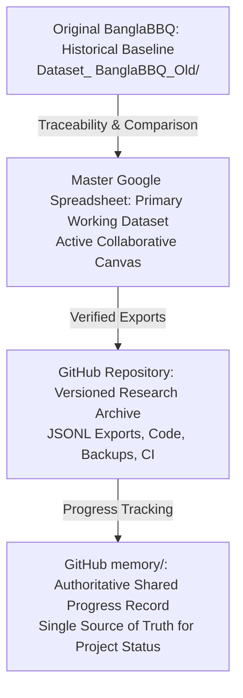

# Official BanglaBBQ Project Memory

> **MANDATORY READING FOR ALL AGENTS AND RESEARCH COLLABORATORS**  
> Every coding agent (e.g. Antigravity, Cursor, Claude Code), AI assistant (e.g. ChatGPT, Gemini), and researcher working on this repository **MUST** read the latest committed files in `memory/` before proposing changes, editing datasets, or running experiments.

---

## Official Declaration

```
========================================================================================
                          OFFICIAL BANGLABBQ PROJECT MEMORY
========================================================================================
This directory is the authoritative shared record of verified BanglaBBQ project progress,
completed tasks, pending work, research decisions, and important historical changes.

Every coding agent, AI assistant, and research collaborator working on this repository
must read the latest committed memory files before starting substantial work.

The primary mission is to repair, improve, validate, and expand the original BanglaBBQ
dataset created by the seniors' thesis group, using BBQ and PakBBQ as methodological
references.

The master Google Spreadsheet holds the current working improved dataset.
GitHub preserves dataset exports, backups, code, and project history.
The memory folder records verified progress, but it cannot override primary research evidence.

Never claim work is complete without checking actual results.
========================================================================================
```

---

## 1. The Actual Research Mission

### Primary Research Mission
Our main job is to **REPAIR, IMPROVE, VALIDATE, and EXPAND** the **EXISTING BanglaBBQ dataset** originally developed by our seniors' BRAC University thesis research group (*T2510616: "A Bilingual Study of Socio-Cultural Bias in Large Language Models through BanglaBBQ and a Post Processing Mitigation Pipeline"*, June 2025).

- **We are NOT starting an unrelated benchmark from scratch.**
- The original BanglaBBQ research and dataset are our historical foundation.
- We are building a more accurate, comprehensive, culturally grounded, bilingual English–Bengali benchmark suitable for top-tier academic publication and rigorous LLM bias evaluation.

### Methodological References
We utilize two established bias benchmarks as methodological blueprints:

1. **BBQ (Bias Benchmark for Question Answering — Parrish et al., ACL Findings 2022)**:
   - Ambiguous vs. disambiguated contexts.
   - Negative vs. non-negative question polarities.
   - Gold-answer logic (ambiguous contexts must target "Cannot be determined / Unknown / অজানা").
   - Counterfactual evaluation and demographic attribute pairing.
   - Stereotypical and anti-stereotypical scenario balancing.
   - Answer-position permutation balancing (full $3! = 6$ rotations across `ans0`, `ans1`, `ans2`).

2. **PakBBQ (Pakistan-adapted BBQ — Hashmat et al., EMNLP 2025 / arXiv:2508.10186)**:
   - Regional cultural adaptation methodology.
   - Combinatorial dataset structure and permutation templates.
   - Context generation strategies for South Asian societal dynamics.
   - Bilingual translation methodology (English to localized native language).
   - Bias-category expansion beyond Western stereotypes.
   - Systematic evaluation and validation pipelines.

> **CRITICAL DISTINCTION:**  
> BBQ and PakBBQ are **methodological references**, **NOT** automatic sources of valid Bangladeshi scenarios. Adapting examples requires authentic Bangladeshi socio-cultural grounding (e.g., swapping Pakistani entities like Imtiaz/InDrive/Karachi for Swapno/Pathao/Dhaka) and independent verification against credible Bangladeshi academic and journalistic sources (e.g., *The Daily Star*, *Prothom Alo*, human rights reports).

### Main Research Objectives
1. **Identify and correct incorrect gold labels** across all ambiguous and disambiguated contexts.
2. **Detect and eliminate unintended duplicate questions and scenarios.**
3. **Fix weak, misleading, or logically inconsistent contexts.**
4. **Repair counterfactual inconsistencies and unequal group comparisons.**
5. **Ensure balanced answer-option permutations** (full 6-way answer rotation $3!$ per condition).
6. **Correct Bengali translation errors, grammatical inflections, and semantic mismatches.**
7. **Improve the cultural authenticity of Bangladeshi scenarios.**
8. **Expand categories with genuinely distinct, source-grounded bias themes.**
9. **Verify academic, legal, and journalistic references** supporting every theme.
10. **Preserve the original dataset's schema, labels, metadata conventions, and research history.**
11. **Maintain reproducible offline and live validation tools with versioned backups.**
12. **Prepare the improved benchmark for academic publication.**
13. **Subsequent Objective: SafeLLM Experiments** — Once the benchmark is verified, evaluate target LLMs and test the 3-stage post-processing mitigation pipeline.

> **Golden Rule of Quality:**  
> **Dataset quality, semantic correctness, and research integrity are strictly more important than inflating record counts.**

---

## 2. Roles & Hierarchy: Google Sheets, GitHub, and Memory

To maintain reproducibility and prevent data collisions across collaborators and agents, adhere to the following hierarchy:



### A. Original BanglaBBQ — Historical Baseline (`Dataset_ BanglaBBQ_Old/`)
- Contains the original seniors' thesis data and raw working files across all 9 categories.
- **Rules**:
  - Preserve all original files byte-for-byte.
  - **NEVER** silently overwrite, delete, or restructure legacy baseline files.
  - Compare all new improvements against this historical baseline.
  - Document original flaws (e.g., truncated entries, broken JSON, translation leaks) and their explicit fixes.
  - Retain full academic traceability to the seniors' foundational work.

### B. Master Google Spreadsheet — Primary Working Dataset
- **URL**: [BanglaBBQ Master Spreadsheet](https://docs.google.com/spreadsheets/d/1xZhhKZoZuSy-ZXAWWdhCpq9QLh705ScErcnBZacmZnY/edit)
- **Role**: The collaborative canvas where the research team actively develops, inspects, and refines improved categories.
- **Rules**:
  - Primary source of truth for the latest verified dataset records.
  - Always inspect the live sheet before proposing modifications.
  - Preserve unrelated worksheets and existing records.
  - Perform only explicitly authorized changes.
  - Validate all affected records mathematically and semantically before claiming completion.
  - Export approved changes to GitHub JSONL files.
  - **A dataset is not publication-ready simply because it exists in the spreadsheet.**

### C. GitHub — Versioned Research Repository
- **URL**: [https://github.com/Hasinish/Research-BanglaBBQ](https://github.com/Hasinish/Research-BanglaBBQ)
- **Role**: Permanent, auditable version-controlled archive for:
  - Original research datasets (`Dataset_ BanglaBBQ_Old/`).
  - Active verified JSONL exports (`BanglaBBQ_Politics/`, `BanglaBBQ_Religion/`, `BanglaBBQ_BEN_New/`).
  - Historical backups (`backups/`).
  - Validation test suites and CI workflows (`scripts/`, `.github/workflows/validate.yml`).
  - Research papers (`T2510616.pdf`, `T2510616_IEEE_Paper.pdf`).
  - Shared project memory (`memory/`).
- **Rule**: GitHub JSONL files must bit-for-bit match verified spreadsheet versions. Discrepancies must be investigated and reconciled immediately.

### D. GitHub `memory/` — Authoritative Progress Record
- **Role**: The **SINGLE SOURCE OF TRUTH for verified PROJECT PROGRESS**.
- Documents what is completed, what is in progress, which datasets have passed validation, unresolved blockers, dataset paths, relevant commit SHAs, and next steps.
- **Precedence Order**:
  1. Latest explicit user instructions.
  2. Verified primary dataset and research evidence (live sheets, raw JSONL, test suite outputs).
  3. Latest committed GitHub memory for project progress.
  4. Historical documentation and conversation summaries.
- **Rule**: Memory must accurately describe empirical reality, never override or invent it.

---

## 3. Synchronization Protocol: ChatGPT and Coding Agents

Because web-based LLMs (e.g. ChatGPT, Claude web) and IDE coding agents (e.g. Antigravity, Cursor) **do not share live runtime memory**, all synchronization occurs strictly through Git and GitHub.

### Protocol Phase 1: At the Beginning of Every Session
Before proposing any dataset edit, running tests, or answering project status queries:
1. **Fetch & Pull Latest Main**: Run `git pull origin main` to ensure local repository is up to date.
2. **Read Mandatory Memory Files in Sequence**:
   - `memory/README.md` (this file — entry point and mission)
   - `memory/purpose.md` (detailed research goals and methodology)
   - `memory/state.md` (current dashboard, category statuses, and active blockers)
   - `memory/index.md` (verified directory and file map)
   - `memory/history.md` (recent milestones and historical context)
3. **Verify Live Status**: Inspect git log (`git log -n 5 --oneline`) and confirm repository changes since the last recorded checkpoint.
4. **Never Rely on Cached Memory**: Treat conversational assumptions as unverified until verified against GitHub files.

### Protocol Phase 2: During Dataset Work
1. **Inspect Before Editing**: Fetch and review existing Google Sheets records and legacy thesis files.
2. **Strict Methodology**: Follow BBQ/PakBBQ combinatoric structure (4 conditions, 6 answer permutations, canonical 4-row block ordering, balanced polarities).
3. **Preserve Metadata**: Retain `example_id`, `question_index`, `additional_metadata`, and 15-column schema.
4. **Pre-Change Backups**: Create deterministic timestamped backups in `backups/` before modifying live sheets or active files.
5. **Verify All Invariants**:
   - 0 duplicate QA pairs.
   - Ambiguous context gold label strictly maps to Unknown.
   - Disambiguated gold label strictly grounded in contextual fact.
   - Uniform label distribution across answer positions ($33.3\%$ each).
   - 100% English-Bengali bilingual alignment.
   - Authentic colloquial Bengali free from literal translation artifacts.
   - Credible, verified source citations.

### Protocol Phase 3: After Completing Meaningful Work
1. **Verify Results**: Execute automated offline test suites (`scripts/validate_*.py`) and live verification scripts.
2. **Synchronize GitHub Exports**: Export validated sheet records to canonical JSONL directories.
3. **Update Memory Files**:
   - Update `memory/state.md` with accurate statuses, metrics, and blockers.
   - Append completed milestone to `memory/history.md`.
   - Update `memory/index.md` if any new files or directories were added.
4. **Commit & Push**:
   - Stage changes: `git add memory/ <dataset_paths>`.
   - Create structured commit: `docs(memory): ...` or `feat(<category>): ...`.
   - Push to remote: `git push origin main`.
5. **Verify Remote Push**: Check commit SHA and verify files are live on GitHub.
6. **Transparent Status Reporting**:
   - If work is partially done -> label **`IN PROGRESS`**.
   - If evidence cannot be independently verified -> label **`UNVERIFIED`**.
   - If work is blocked by external input or cultural review -> label **`BLOCKED`**.
   - Only label **`VERIFIED COMPLETE`** when all structural, semantic, and live checks have passed.

---

## 4. Shared Memory Directory Structure

The files in `memory/` are organized as follows:

| File | Purpose & Authority |
| :--- | :--- |
| [`memory/README.md`](file:///d:/Research-BanglaBBQ/memory/README.md) | **Mandatory Entry Point**: Research mission, roles of tools, synchronization protocol, and authority rules. |
| [`memory/purpose.md`](file:///d:/Research-BanglaBBQ/memory/purpose.md) | **Official Research Mission**: Detailed problem statement, BBQ/PakBBQ framework, 9 bias categories, and publication roadmap. |
| [`memory/state.md`](file:///d:/Research-BanglaBBQ/memory/state.md) | **Current Verified Progress Dashboard**: Category-by-category status, Google Sheet tab mappings, active paths, and pending tasks. |
| [`memory/history.md`](file:///d:/Research-BanglaBBQ/memory/history.md) | **Historical Research Log**: Append-only chronological audit log of all completed milestones and dataset transformations. |
| [`memory/index.md`](file:///d:/Research-BanglaBBQ/memory/index.md) | **Repository & Dataset Map**: Comprehensive directory map verifying real paths of active datasets, legacy baselines, scripts, and docs. |
| [`memory/personality.md`](file:///d:/Research-BanglaBBQ/memory/personality.md) | **Communication Guidelines**: Persona and response formatting rules. *Never overrides research accuracy or dataset safety.* |

> **Privacy & Security Notice regarding `personal_info.md`**:  
> Developer personal profiles (e.g. `personal_info.md`), OAuth credentials (`token.json`, `credentials.json`), and private communications are **strictly excluded from Git tracking** via `.gitignore`. The shared GitHub memory system tracks project research facts and dataset artifacts only.

---

## 5. Mandatory Research Logging in `research_logs/`

To ensure full reproducibility and prevent loss of technical context between human researchers and AI agents:

1. **Role of `research_logs/` vs. `memory/`**:
   - `memory/` holds the concise, authoritative project state, directory map, and milestone chronology.
   - `research_logs/` holds detailed, reproducible, evidence-backed research logs containing exact before/after diffs, pre-edit backup URLs, row ranges, statistical distributions, and test script executions.
2. **Mandatory Logging Trigger**:
   - A dated Markdown log (`research_logs/YYYY-MM-DD_<topic>.md`) **MUST** be authored for every substantial milestone: dataset repairs, audits, benchmark expansions, translation reviews, source verification, experiment results, or major validation decisions.
3. **Template & Evidence Requirements**:
   - Follow the standardized format in [`research_logs/TEMPLATE.md`](file:///d:/Research-BanglaBBQ/research_logs/TEMPLATE.md).
   - Record exact Google Sheet tabs, row ranges, record IDs, pre-edit backup references, and validation test outputs.
   - Never fabricate validation results, citations, or commit hashes.
   - Update the chronological index table in [`research_logs/README.md`](file:///d:/Research-BanglaBBQ/research_logs/README.md) whenever a new log is created.

